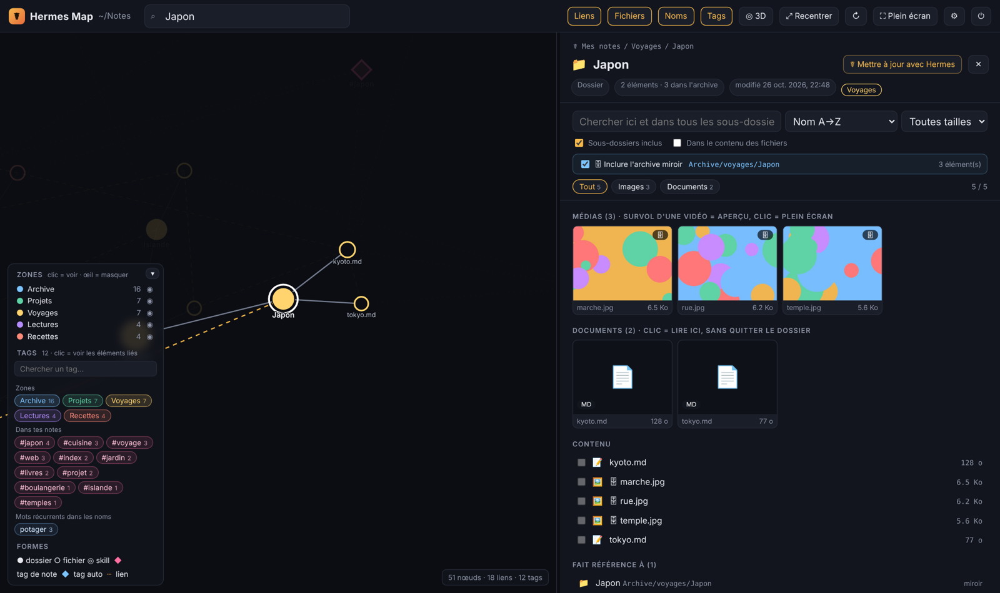

# Hermes Map

A visual explorer for your notes folders: a mind map of folders, files and the links between them, with a reading panel on the right. Built as a companion for the **Hermes** agent (`hermes` command), it also works without it on any folder of notes — Markdown, an Obsidian vault, iCloud Drive…



> English and French interface — switch with the **FR / EN** toggle in the header. 🇫🇷 Guide en français : [LISEZMOI.md](LISEZMOI.md)

## Features

- **2D map and 3D sphere** of your folders, with one colour per top-level folder (“zone”).
- **Links between notes**: Markdown links, `[[wiki links]]`, file paths quoted in text, skill mentions.
- **Tags**: front-matter `tags:` and `#hashtags`, plus automatic tags from words that recur across branches.
- **Search everything**, including folders the map does not draw, and optionally inside file contents.
- **Reading panel**: rendered Markdown, image / GIF / video galleries, PDF and Office previews, SQLite tables, chat logs; secrets (`.env`, `auth.json`) are masked.
- **Optional storage folder**: keep notes in the folders you pick and binaries in a mirrored storage tree (`Personal/trips/japan.md` ↔ `Storage/personal/trips/`); the map shows both together.
- **Move / rename** files by hand, with catalogue, log and note links updated — and undo.
- **With Hermes installed**: “Update with Hermes” (links, tags, INDEX.md from where you are) and “Reclassify with Hermes” (analyse, rename, file away), with live activity on the map, a backup before every run, a full diff and one-click undo.

## Download (Mac, Windows, Linux)

Ready-to-run builds are attached to each release on the [Releases page](https://github.com/AnthonyDpz/HermesMap/releases) (built automatically by GitHub Actions from the Rust version in [`rust/`](rust/)):

| System | File | First launch |
|---|---|---|
| macOS (Apple Silicon and Intel) | `hermes-map-macos.zip` | Unzip, move **Hermes Map.app** to Applications, then right-click → **Open** (the app is not notarised by Apple). Grant **Full Disk Access** to read iCloud Drive. |
| Windows 10 / 11 | `hermes-map-windows-x86_64.zip` | Unzip and double-click **Hermes Map.exe**. If SmartScreen warns, click **More info → Run anyway** (the app is not signed). |
| Linux (x86_64) | `hermes-map-linux-x86_64.tar.gz` | Extract and run `./hermes-map`. |

The app opens in your browser. Launching it again while it runs reopens the page; it stops by itself two minutes after the last tab is closed.

Build it yourself: `cd rust && cargo build --release` (Rust 1.77+).

## Install from source (macOS)

Requires Apple's command line tools (they also provide Python 3):

```
xcode-select --install
git clone https://github.com/AnthonyDpz/HermesMap.git
cd HermesMap
./macos/build_app.sh --install
```

Then launch **Hermes Map** from Spotlight. The first launch shows a setup screen: it detects Hermes, suggests where your notes are (iCloud Drive, Obsidian vaults, `~/.hermes`, Documents), lets you tick the folders that hold your notes, and asks whether to centralise files in a mirrored storage folder. To read protected folders such as iCloud Drive, grant the app **Full Disk Access** when prompted.

## Run from source (macOS / Linux)

```
python3 hermes_map.py
```

Python 3.8+ only, no dependencies. Thumbnails and Office previews use macOS tools (`sips`, `qlmanage`, `textutil`); `ffmpeg`, if installed, converts AVI/MKV videos for playback.

## Translations

The interface text is written in French in the code and translated at display time with [`static/i18n/en.json`](static/i18n/en.json) (shared by the page and the server). After changing the interface, run `python3 tools/i18n_extract.py` to list the strings that still need an English translation.

## Privacy

The server listens on `127.0.0.1` only, write actions require a per-launch token, and nothing is sent to the internet. Browsing is read-only; files are only changed by the actions you start (Hermes update, reclassify, move), always after a backup and with undo. Settings live in `~/Library/Application Support/hermes-map/config.json`.

## Support

Hermes Map is free and open source. If it is useful to you, you can [sponsor the project on GitHub](https://github.com/sponsors/AnthonyDpz) ☕

## License

MIT — see [LICENSE](LICENSE). Bundled libraries: see [THIRD_PARTY_NOTICES.md](THIRD_PARTY_NOTICES.md).
